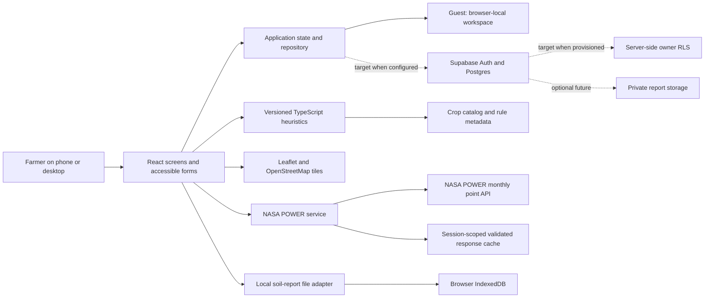
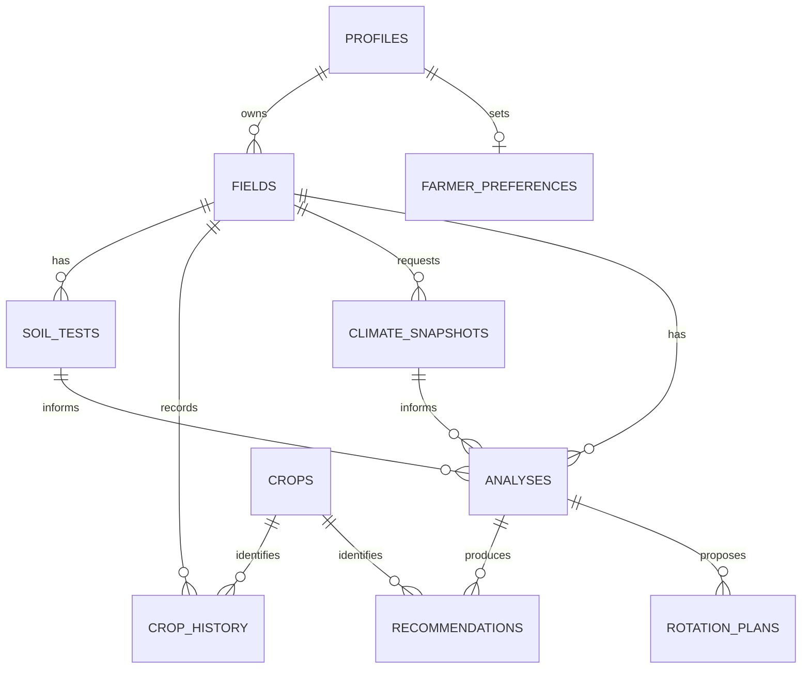

# TerraWise project specification

**Purpose:** A mobile-first agricultural decision-support application that helps farmers document fields and explore explainable, multi-season crop rotations using farmer-provided inputs and appropriately attributed historical climate data.

**Authority and scope:** The five-page [original requirements PDF](.docs/TerraWise_Complete_Project_Requirements_EN.pdf), sections 01–20, is the source of product requirements. The [four supplied reference images](.design-references/) inform the dashboard, field/soil entry, crop results and account experience. They are examples, not authorization to invent soil measurements, crop outcomes, yields, prices, profits or scientific validation. The reference image's example financial figures are therefore not prescribed application output. [REQUIREMENTS_GAP_ANALYSIS.md](REQUIREMENTS_GAP_ANALYSIS.md) maps the requirements and references to the implementation; [IMPLEMENTATION_STATUS.md](IMPLEMENTATION_STATUS.md) is the authoritative record of completed integration, verification and remaining blockers.

See [REAL_DATA_AUDIT.md](REAL_DATA_AUDIT.md) for the real-data inventory, legacy-record treatment and source-specific limitations. This document describes both the **local implementation** and the **target production design**. A proposed service, table, policy, route or feature is not necessarily provisioned or verified. The application is a decision-support prototype: local agronomic review, soil testing and context remain necessary before a consequential planting decision.

## Users and experience

- **Farmer:** enter or edit fields, inspect climate sources, compare crops, construct rotation plans, and review or export saved work. The local workspace contains farmer entries and does not authenticate a user.
- **Potential agronomist or administrator:** review crop knowledge and references and maintain catalog/rules in a future authorized workflow. No role-based administrative review should be implied until both authorization and audit capabilities exist.
- **Potential researcher:** use only appropriately consented and de-identified aggregate data under a separately designed permission process.

The intended flow is: welcome or explicit guest mode → create a field → set a point location and area → enter available soil, water, crop history and objectives → retrieve or explicitly select climate data → validate and run analysis → inspect exploratory crop profiles and alternatives → save, rerun and export. Every stage must identify missing inputs, source, limitations and errors. Uploading a report does not itself perform OCR or measure soil chemistry.

## System architecture

The project uses React, Vite, TypeScript, Tailwind CSS, React Router, Lucide icons, Leaflet with attributed OpenStreetMap tiles, and Recharts. `src/lib/recommendations.ts` is deliberately independent of React; crop data and parameter defaults are in `src/data/`. Browser storage and NASA POWER access are separated behind services. The codebase and status file, rather than this diagram, determine what is currently wired and tested.



The UI and service modules must not expose privileged credentials. The diagram's dashed cloud paths describe a target integration and do not establish that an account system, cloud data isolation, storage, or service is live. NASA POWER is public and does not require a secret key.

## Pages and responsibilities

| Page | Route or intended route | Required behavior |
|---|---|---|
| Welcome | `/about` | Explain value, workflow, sources and limitations; offer entry to an explicitly labeled guest experience. |
| Sign in / sign up | `/login`, `/signup` | Clearly distinguish the local workspace from actual provider-backed registration. Email verification, reset and secure session behavior depend on configuring and verifying a provider. Social sign-in is optional future work. |
| Dashboard | `/`, `/dashboard` | Summarize active fields and their climate source, link to analysis, show saved/recent work and actionable errors. |
| Fields | `/fields`, `/fields/new`, `/fields/:id`, `/fields/:id/edit` | Search, create, edit, review and archive/restore fields; enter validated location, soil, water and previous crops. Maps represent a point, not an established field boundary. |
| Recommendations | `/recommendations` | Select active field and planting window, inspect unranked crop profiles, explanations, data quality and comparisons. |
| Rotation planner | `/planner` | Compare and edit multiple sequential crop plans, identify family transitions, retain assumptions and risks, save and export a plan. |
| Analysis and reports | `/analysis`, `/history`, `/history/:id` | Run real validation/climate/calculation steps, preserve a dated snapshot and re-run it; support a printable report / browser Save as PDF. The final status file records whether the paths are fully integrated and tested. |
| Settings and sources | `/settings`, `/data-sources` | Manage applicable local preferences and export, explain dataset provenance and model limits; actual account deletion and policies require server-side support and review. |

The target includes both English LTR and Arabic RTL. Do not represent a partial translation, inaccessible control, unavailable export or future legal/policy page as finished. Screens should support keyboard navigation, labels, clear loading/error/empty states and mobile layouts. A real-device and assistive-technology audit remains separate from desktop viewport emulation.

## Field and farmer-input data contract

`src/types.ts` defines the current TypeScript records. Fields are stored with an internal identifier, name, region, decimal latitude/longitude, canonical area in hectares, qualitative water availability, soil record, previous crops, farmer priorities and an illustrative image. Optional metadata includes country, display area unit, elevation, location source, soil type and archive status. Hectares and acres are presentation/input units; calculations and storage must use a clear canonical unit.

Soil values are nullable, not automatically filled: pH (0–14), available N/P/K (mg/kg in the starter model), organic matter (%), optional electrical conductivity/salinity (dS/m), texture, sample date and depth, laboratory and extraction/test method, moisture and input provenance (`measured`, `estimated` or `unknown`). Laboratory methods and units affect interpretation; the starter N/P/K screens are not fertilizer recommendations. New workspaces contain no sample records. An entered value must never be attributed to NASA or described as a laboratory measurement without that provenance.

Crop history identifies the crop, season and year, with optional planting/harvest dates, disease notes and residue handling. History is ordered using the documented calendar convention: Winter, Spring, Summer, Autumn within a recorded calendar year; Winter means the start-of-year window. The planner uses illustrative Spring and Autumn windows. Water metadata may include method, source and seasonal restrictions. Objectives can include water saving, soil health, production and risk preference; budget and risk tolerance are optional context, and financial/production priorities cannot be converted to yield or profit forecasts without credible local data.

The soil-report adapter in `src/services/soilReports.ts` is browser-local: it accepts PDF, JPEG, PNG or WebP up to 5 MiB, checks both the reported MIME type and file signature, and stores report blobs in IndexedDB. The file is not automatically sent to NASA and no chemistry is inferred from it. UI integration, consent, preview and deletion must be verified in the status report. Browser-local storage is not a private multi-user cloud store and is not a substitute for a backup or an access-control policy.

## NASA POWER data contract

The intended and implemented data-access boundary is [`src/services/nasaPower.ts`](src/services/nasaPower.ts). The service requests the public [NASA POWER monthly point endpoint](https://power.larc.nasa.gov/docs/services/api/temporal/monthly/) with `community=AG`, JSON format, decimal `latitude`/`longitude`, `start`/`end` years and the following parameters:

| Parameter | Meaning | POWER AG source units | Application output |
|---|---|---|---|
| `T2M` | Mean air temperature at 2 m | °C | °C, monthly mean |
| `PRECTOTCORR` | Corrected precipitation rate | mm/day | mm per month: rate × days in the calendar month, including leap February |
| `ALLSKY_SFC_SW_DWN` | All-sky surface shortwave radiation | MJ/m²/day in the checked AG response | kWh/m²/day, divided by 3.6; already-supported kWh units are not converted again |
| `RH2M` | Relative humidity at 2 m | % | %; an unavailable or invalid value remains unknown |

POWER provides gridded historical climate assembled from Earth-observation products and models; these are not laboratory soil measurements, point sensors, forecasts, or a guarantee of the microclimate of a specific field. Do not describe pH, N, P, K or other lab results as NASA observations. For climate interpretation and data availability, consult [NASA POWER temporal API documentation](https://power.larc.nasa.gov/docs/services/api/temporal/) and the [parameter dictionary](https://power.larc.nasa.gov/parameters/).

The request builder validates coordinate ranges and a bounded, complete historical year range. The parser validates response shape, units, missing/fill values and physical bounds; an incomplete core temperature, precipitation or radiation series is rejected rather than converted into an observation. Missing humidity is retained as `null` and marks the result partial. Each accepted retrieval records provider, exact requested coordinates, parameter names and source/display units, requested period, retrieval timestamp, data-quality status, missing values and whether the response was newly fetched or cached. Multi-year records retain per-year monthly values; annual summaries that use the simple mean of monthly means and the sum of monthly precipitation are descriptive, not drought/heat forecasts.

Requests have a timeout, support cancellation and expose retry/error information. A validated raw response may be cached for the exact coordinates and period in the current browser tab's `sessionStorage`; a cache hit on failure must retain its original retrieval time and carry a cached label. An invalid, unavailable or mismatched cache must not be labeled NASA data. If no valid data or cache is available, the UI reports that data is unavailable and makes no climate-dependent recommendation. A location change must not display the previous field's climate under the new field's name. Location coordinates are sent to NASA when a field climate request is made.

## Crop recommendation and rotation model

The prototype is a configurable, uncalibrated **heuristic**, not a trained AI model. `MODEL_VERSION` identifies the rule set associated with a saved analysis. The starter catalog contains eight illustrative crops and identifies botanical families; catalog/reference links support general taxonomic and crop-rotation concepts and do **not** independently validate the numeric thresholds. The current illustrative windows target a northern Mediterranean starting catalog and must not be represented as universally applicable. Before operational use, localize rules, soil test methods, crop varieties, sowing windows and risk factors with an agronomist, and add rule-specific citations, applicability and review dates.

1. **Constraints:** The generic framework distinguishes compatible, incompatible and unknown. No current crop rule has documented scientific validation, so critical constraints remain unknown. Starter seasons are interface windows, not verified exclusions.
2. **Factor evidence:** Available temperature, pH, full N/P/K and crop history have individual unvalidated starter comparisons. Missing inputs remain null, as do water fit and priorities. Historical 25/15/15/20/20/5 weights are assumptions only and are not combined.
3. **Water and ranking:** Water needs, effective rainfall and irrigation volume lack a validated water balance. Overall suitability and ranked recommendations are withheld, not renormalized or treated as zero. At most four unranked profiles appear per page. The ranking framework permits up to four only after complete comparable evidence and reviewed rules exist.
4. **Completeness and confidence:** Completeness counts eight tracked input categories, including water balance; it is not scientific confidence. Confidence remains low because scientific rules and critical inputs are unverified.
5. **Plans:** Family-diverse alphabetical scenarios are editable, saveable and exportable. They do not establish compatibility or predict crop outcomes. Old saved snapshots keep their stored values but legacy overall scores are not displayed as current results.

General agronomic background is available from [University of California crop rotation guidance](https://ucanr.edu/site/uc-master-gardeners-sacramento-county/crop-rotation), [University of Minnesota Extension's soil-health guidance](https://extension.umn.edu/garden-and-home/yard-and-garden/gardening-in-minnesota/living-soil-healthy-garden), and [FAO's indicative crop water needs](https://www.fao.org/4/S2022E/s2022e07.htm). These sources support general practices; they do not validate TerraWise's particular numerical weights, caps or ranges.

## Persistence and database model

The existing guest workspace uses a validated field repository and browser-local persistence for fields, plans and preferences. Saved analysis records are designed to retain their identifier, creation time, field/soil/history snapshot, climate snapshot and provenance, planting window, recommendations and model version. Records should be validated before rendering, preserve honest source labels and avoid rewriting damaged saved data silently. Local storage can be disabled, corrupted, cleared or exhausted; a useful error must be shown, and data in one browser does not automatically synchronize to another device.

The following is the **logical target** from PDF §12, not a claim that these relational tables, indexes, migrations or backups have been deployed:



The corresponding target entities are `profiles`, `fields`, `crop_history`, `soil_tests`, `crops`, `climate_snapshots`, `analyses`, `recommendations`, `rotation_plans` and `farmer_preferences`; their key inputs and ownership/foreign-key relationships are specified on PDF pp. 3–4. Soil reports need a private storage design tied to the owner/field. The repository's MVP migration, [`supabase/migrations/20261111_workspace.sql`](supabase/migrations/20261111_workspace.sql), defines an owner-keyed `terrawise_workspaces` table containing fields, plans, preferences and analyses as JSON, with owner-specific select/insert/update/delete policies. This simpler workspace adapter is not the complete normalized schema above. Its existence in source does not mean the migration has been applied or the policies have been verified against a running database.

The `supabaseWorkspace.ts` adapter requests the signed-in owner's row and writes with a version predicate so stale tabs are surfaced as conflicts. For actual multi-user release, configure Supabase Auth, Postgres and, if needed, private Storage; apply least-privilege grants and Row Level Security to every exposed user-owned table; enforce owner checks on reads **and** writes; and test anonymous, owner and different-user access. [Supabase RLS guidance](https://supabase.com/docs/guides/database/postgres/row-level-security) explains server-side policies and `auth.uid()`. An anonymous/publishable client key may be public, but a service-role or secret key bypassing RLS must never be included in client code, static assets or `VITE_` environment variables. No live project, user-isolation guarantees, production email delivery or cloud backup should be claimed until provisioned and tested.

## PWA, privacy and operational boundaries

The repository contains a web app manifest, responsive layout, and a production-registered service worker intended to cache the static application shell. Their presence alone does not establish installability, offline correctness or safe update behavior. Service workers require an appropriate secure context such as HTTPS or localhost; the cache/update policy and sized install icons need device-specific verification and further production work. Consult [MDN's service worker guide](https://developer.mozilla.org/en-US/docs/Web/API/Service_Worker_API/Using_Service_Workers). Offline handling must not silently substitute simulated values for NASA data. Browser caching must not leak authenticated field records across users.

Access to device location must be user initiated and require browser consent. OpenStreetMap tile requests disclose the viewed map area to the tile service. NASA mode sends the field point to NASA POWER. A soil-report upload must require the user's action, validate file type and size, explain its storage location, and never expose a private report through a public bucket. Define retention, backup, export and deletion policies before public accounts. Do not imply that a privacy policy or terms have been legally reviewed until that work has actually happened.

Hosting, HTTPS, SPA route fallback, secure configuration, monitoring, backup/restore, incident response and legal review are production responsibilities. The original request requires the user's approval before public deployment. A local workspace is not an authenticated account, and public-release isolation cannot be verified without configured external services and a two-user test.

## Development and verification

From the project directory, with a supported Node.js version installed:

```powershell
npm ci
npm run dev
```

Use the local URL printed by Vite. NASA historical data is the climate source; there is no simulated fallback. No NASA API key is needed. With an appropriate environment configured, provider-backed accounts require the project URL, a publishable/anon key, applied migrations, verified RLS, and configured authentication email/redirect settings; consult the implementation status before using that path. Do not place a service-role key in the frontend.

```powershell
npm test
npm run build
npm run preview
```

Browser checks in `scripts/qa-app.mjs`, `scripts/qa-fields.mjs` and `scripts/qa-decisions.mjs` use an isolated Playwright browser context; they require a running local server and an installed compatible browser. `BASE_URL` and `BROWSER_PATH` can select the server/browser. Synthetic test fixtures must remain clearly labeled and must never ship as actual NASA observations. Inspect [IMPLEMENTATION_STATUS.md](IMPLEMENTATION_STATUS.md) for final command results, exact verified scopes and outstanding requirements.

Acceptance verification should include: validation of pH and coordinates; user consent for GPS and report selection; field/edit/reload and local-storage failure paths; source/date/units and a real NASA request as well as API-error and exact-location cached and no-data failure paths; missing inputs and soil/water/history score sensitivity; at least two explainable rotations; compare/save/rerun/report flows; keyboard and phone/tablet-sized browser checks; and production build/type checks. Secure account verification additionally requires a real configured project, email flows, database/RLS tests proving two accounts cannot access one another's data, and private-file access tests. Physical-device testing, agronomic calibration, multilingual/RTL completion, legal review and public deployment must remain open until separately evidenced.
